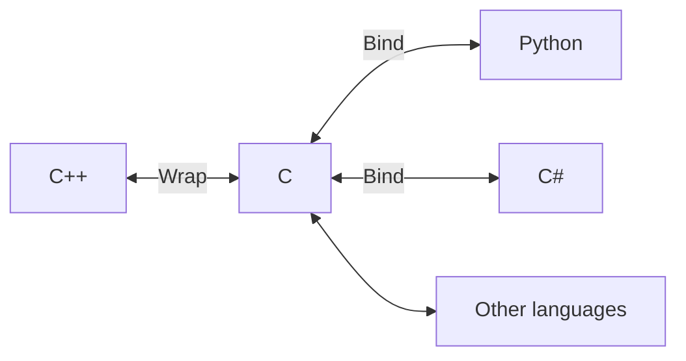

Multi-language C++ library bindings example
===

This is an attempt on binding C++ library to other object-oriented languages by utilising C wrapper. The primary goal of is to demonstrate how the C++ library can be wrapped into C and loaded into other languages. Class function is not the primary focus.

Why?
---

I know there are tools like SWIG. SWIG gives you a uniform method names, but not idiomatic. Other approach might only involves a single language. This approach gives you freedom to create your own, idiomatic, implementation for the target language.

Suppose you already have the C++ library and cannot make any changes (compiled, maybe), or you have a simple library and want to use it in another language without rewriting. This approach utilises C to wrap object-oriented parts of C++, and binds it in another language easily, without having to deal with C++ types. The bindings can be written back in the form of object-oriented classes. Write the wrapper once, bind it in many languages!

Oh you already have the C wrapper? Great! Because in this approach, other language only sees the C parts instead of the C++ parts. No need to be worried about C++ types. Hence, using C as the base makes the porting easier.

How it works?
---

What is inside?
---

This library contains several classes, demonstrating how to work with different level of complexity.

- `calculator`
  - simple class

- `circular buffer`
  - dynamic memory allocation
  - exception handling

- `animal`
  - (multi-level) inheritance
  - polymorphism
  - method overloading

- `number processor`
  - abstract class
  - proxy implementation for inheriting the class in the target language
  - object registry for downcasting ffi-returned object
